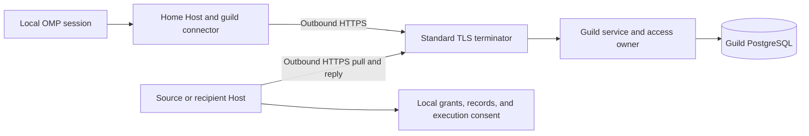

# Cross-House guild bridge

Status: proposed design. No guild bridge is implemented or deployed by this document.
This design extends the planned OMEGA access boundary. It does not change the current 1.0 release boundary.
It defines an implementation candidate and its release gates. All proposed identifiers and routes below are new contracts.

## 1. Purpose and boundaries

A participant keeps a home House while joining a guild hosted elsewhere.
The participant can exchange Hallway messages, request permitted turns, work on quests, and inspect explicitly shared records.
Guildkeepers can manage the board and help participants from another House.

The guild service owns its membership, Hallways, board, and operation receipts.
Each source House owns its records and export grants.
The home Host owns its connector and local execution consent.
The existing OMP home connection remains unchanged.

The first hosting profile is AKASHA. This follows the planned OMEGA hosting requirement in [Roadmap](roadmap.md#omega-organization-layer).
Vault and AKASHA Houses can participate. Section 10 defines both local storage contracts.
No PostgreSQL or NATS connection crosses the House boundary.
The proposed guild credential path gives callers no destination Host bearer, SSH key, or database credential.

This design excludes a marketplace, public identity directory, global reputation ladder, and remote machine administration.
It excludes private-record writes and automatic publication of local memories.
A guild office confers duties. It confers no ownership of another participant.

## 2. Current source and proof limits

The inspected working tree supplies these facts. Line references identify the inspected versions, not an immutable release.

| Fact | Current owner and evidence |
|---|---|
| A Host bearer authenticates access to its command socket | `crates/host/src/server.rs:299-345` |
| Commands must match the configured House, room, and embodied spirit; the session remains caller-supplied | `crates/host/src/server.rs:2694-2740` |
| Organ parameters cannot override the bound identity | `crates/host/src/organ/mod.rs:211-228,296-391` |
| One multi-room House listener shares a bearer and storage configuration | `crates/host/src/house.rs:219-249` |
| OMP uses one process-wide, loopback Host destination | `adapters/omp/house-proof/host.ts:89-111,114-161` |
| Hallway presence and membership use local room identity | `crates/origami/src/hallways/channels.rs:21-85` |
| Message retries compare content; addressed recipients require membership | `crates/origami/src/hallways/messages.rs:46-149` |
| Hallway broker projections carry room addresses and record pointers | `crates/origami/src/hallways/sea.rs:6-25,59-85` |
| Current Knock expiry marks claimed and started rows failed; guild uncertainty needs a changed transition | `crates/origami/src/hallways/knocks.rs:596-613` |
| OMP can trigger a bounded turn; an environment setting disables its doorman | `adapters/omp/house-proof/knock.ts:247-275,384-444` |
| Docket uses a coarse room capability | `crates/akasha/src/docket/capability.rs:7-28` |
| Claim reports require the claimant room; review excludes that room | `crates/akasha/src/docket/report/mod.rs:38-155` |
| Recall combines room scope with an optional operator filter | `crates/akasha/src/recall/mod.rs:119-148`; `recall/scope.rs:33-78` |
| Portable attachment obtains identity from the serving room | `crates/host/src/portable/attach.rs:107-115` |
| The Host declares `reqwest` 0.12 with `rustls-tls`; no guild call site is established | `crates/host/Cargo.toml:24` |
| The separate remote client distributes a Host token and SSH key, then exports the token to OMP | Client repository: `client/config.ts:3-17`; `client/launcher.ts:99-101,174,197-219` |

The current shared bearer does not prove a human identity. An operator label does not repair that boundary.
A multi-room House listener and a separately restricted remote room installation have different exposure.
A client credential alone does not prove access to every remote room.

The legacy remote-client credential path is outside guild guarantees.
Before source-record access ships, inventory and retire credentials that bypass the new source grants.
Rotate affected destination tokens and tunnel keys through the installation path.
Migrate supported remote clients to delegated enrollment before removing their old connection path.
Do not claim that every room is exposed by one token; inspect the actual listener and tunnel restrictions.

The dated OMEGA census predates the current operator filter. Its source references must not override current executable behavior.
That filter still does not establish an authenticated person or a cross-House export permission.

An isolated Bun smoke ran on 2026-10-13 UTC; its sanitized receipt is [guild helper smoke](guild-helper-smoke.json).
It observed local routing, external-URL refusal, process-wide destination replacement, and rejection of an unknown client `guildRole` field.
The smoke made no network requests. It proves those helpers only.
No new guild route, authentication ceremony, migration, or two-House exchange has been exercised.

## 3. Identity and trust

### 3.1 Separate identities

Names are display labels. The service uses UUIDs for authorization and references.

| Identity | Authority |
|---|---|
| `guild_id` | The guild service mints it once. Moving the service preserves it. |
| `house_enrollment_id` | The guild approves one home House within this guild. It is not a global identity claim. |
| `operator_id` | The service enrolls a human account under that House enrollment. |
| `spirit_id` | The enrolled House attests a resident identity; the guild approves its registration. |
| `room_id` | The enrollment maps an opaque room ID to a local room. |
| `membership_id` | The guild records an operator, a spirit, or an explicit operator/spirit pairing. |
| `device_id` | The guild enrolls a connector installation and its allowed operator. |
| `guild_session_id` | The service mints a session bound to a device and one membership. |
| `execution_id` | The recipient Host identifies one local execution instance. |

A membership outlives a device or session. A device does not acquire every membership in its House.
A spirit can occur with different operators. Those pairings can have different grants.
Two Houses can use the same labels without sharing identity.
The same person across independent enrollments is not automatically recognized. No global human uniqueness is claimed.

### 3.2 Trust ceiling

The destination trusts an approved House to attest its residents and local session bindings.
This proves which enrolled House made an assertion. It does not prove model internals or personhood.
An operator's device credential proves delegated use of an enrolled installation, not current human presence.

The existing shared home bearer remains a local administration credential.
A guild operation also requires an enrolled local session capability bound to its approved membership and execution instance.
The trusted launcher obtains that capability after the verified local approval described in section 4.
Ordinary room APIs cannot mint it or select another actor.
The connector checks the capability, active device, current room binding, and approved actor before remote dispatch.
The command body cannot override those fields.

The trusted home administrator can still control its Host and residents.
The present same-user arrangement provides no isolation from model sessions with unrestricted shell access under that user.
Protocol checks do not protect credentials from a process that can read or modify the connector's protected state.
Privileged production deployment must isolate that state from harness processes through an OS principal or a tested sandbox boundary.
Development mode without isolation permits synthetic fixtures only.
It refuses real-participant delegation, export grants, origin changes, and elevated offices.
Compromise of the trusted Host remains outside the protocol guarantee. The release gate must verify the chosen deployment boundary.

### 3.3 Membership and offices

Every active member is an Adventurer. Adventurer rank is optional and separate from membership and office.
The initial rank is unset. No rank grants access.

Guildkeeper and Guildmaster are offices with explicit duties and resource selectors.
A Guildkeeper can receive board management, board review, Hallway support, and record-read request duties.
A Guildmaster can receive membership and office administration duties.
Neither office grants private records or bypasses review independence.

The initial private rollout creates three separately revocable pairing grants for the operator's chosen spirits.
Actual names, IDs, and the bootstrap Guildmaster require a private deployment receipt.
The public implementation must contain no special-case participant names.

## 4. Enrollment and credential custody

Enrollment requires explicit human approval. A TTY or a model-written confirmation is not proof of that approval.

Local delegation, source-grant changes, origin changes, and recovery require a user-verified authenticator registered to the local operator.
The source or home Host verifies that assertion against its own protected operator registry.
Each assertion binds a fresh nonce, target House, action digest, and expected resource revision.
The nonce expires and is consumed once. A remote guild cannot approve a local export grant on the operator's behalf.
The local granting operator is that authenticated ID, never the configured `HostConfig.operator` label.
Initial local authority provisioning requires native installation approval under the OS administrator boundary.
Existing display labels require an explicit, verified mapping before they can supply grantor visibility.

1. An authorized Guildmaster creates a single-use invitation with a subject ceiling, expiry, and intended House enrollment.
2. The invitee opens the guild's HTTPS enrollment page and registers a user-verified passkey.
3. The local connector creates a device secret with 256 bits of entropy and submits its hash through the enrollment transaction.
4. The service creates pending membership and device records. No pending record authorizes work.
5. The approver verifies the displayed enrollment and device fingerprint through an independent channel.
6. The service activates only the approved subject and duty ceiling.
7. The operator uses the local verified ceremony to approve the room sessions that may use the delegated membership.

The invitation expires after 24 hours. This is an initial operating limit, not a measured optimum.
Redemption consumes the invitation transactionally. A replay returns the original pending receipt to its authenticated redeemer or refuses.
It cannot create a second device or widen a grant.

The implementation uses a maintained WebAuthn library for the human ceremony. It does not implement passkey cryptography.
Passkeys protect enrollment, local delegation, source-grant changes, origin changes, credential recovery, and privilege changes.
Routine Guildkeeper duties use standing, scoped, revocable delegation. They do not require a new human gesture every thirty minutes.
Grant creation requires verified approval; a sensitive grant can additionally require approval for each read.

Device credentials stay in the connector's protected local secret store.
Only hashes enter the guild database. Product code must not put credentials in prompts, room metadata, logs, or model-readable invitation files.
A guild session token is opaque, audience-bound, and valid for at most 15 minutes.
Its lifetime does not replace an active-grant check on each operation.
The connector can renew a session only while the device and delegated membership remain active.

The service derives an internal `AuthorizedActor` from the authenticated session and stored rows:
`{guild_id, house_enrollment_id, membership_id, operator_id?, spirit_id?, room_id?, device_id, guild_session_id, authority_epoch}`.
It rejects caller-supplied actor objects. Resource IDs in operation arguments remain ordinary, checked references.

Removal, suspension, duty reduction, and custodian loss increase the membership authority epoch.
Every queued job, Knock, and quest attempt captures that epoch.
Dispatch, start, report, and result release compare the captured epoch with the current epoch and refuse a mismatch.
Reinstatement does not revive old work. A new authorized request is required.
Retain this field to fence previously admitted work, not to replace active-grant checks.
Credential revocation closes the affected device sessions.
Pending work cannot obtain new authority from an earlier token.
Device rotation uses a pending credential and an explicit acknowledgment before retiring the old credential.
The connector stores the pending secret before acknowledgment, so a crash has a recoverable credential.

## 5. Topology and closed protocol

A dedicated loopback guild listener mounts only the guild router.
A standard TLS terminator exposes that listener. Ordinary room, panel, portable-session, and native administration routers are absent.
The connector verifies TLS certificates and the configured origin. It refuses redirects and unapproved origin changes.
Adding or changing a guild origin requires the local verified ceremony. Messages cannot select URLs or network destinations.

Use the existing `reqwest`, rustls, axum, UUID, and SQL primitives.
The wire uses versioned JSON over HTTPS. This is an application contract, not a new cryptographic transport.
The home Host remains the OMP endpoint. The guild is an explicit target on new guild operations.

The proposed route families are closed:

| Family | Operations |
|---|---|
| Enrollment | Invite, redeem, approve, revoke, rotate |
| Session | Open, close, inspect authority |
| Membership | Read permitted directory; grant or revoke bounded duties |
| Hallway | Create, admit or remove a member, post, reply, read, acknowledge |
| Knock | Request, pull, claim, start, complete, fail |
| Board | Read, draft, activate, claim, progress, submit, inspect evidence, settle item |
| Records | Request a source read, admit it at the source, deliver a bounded result or refusal |

`/guild/v1/command` accepts a closed operation tag and its typed payload.
`/guild/v1/pull` returns a bounded page for the authenticated connector.
Enrollment and session routes do not accept ordinary organ requests.
Unknown operations and unknown fields refuse. There is no generic proxy to Recall, SQL, a shell, or a Host command.

Each mutation includes `guild_generation`, `correlation_id`, `idempotency_key`, and the expected resource revision when applicable.
The service supplies the actor and current grant revision.
Each receipt contains the guild, resource, operation, actor reference, disposition, and committed revision, and echoes `correlation_id`.
A response distinguishes `committed`, `duplicate`, `pending`, `refused`, and `outcome_unknown`.
A timeout never becomes a success or an unconditional retry with a fresh key.

The guild service authenticates every pull and rechecks authority before it exposes an item.
Read-result jobs name the source enrollment and requesting membership; the caller cannot choose a destination URL.
Before executing a read, the source calls the idempotent `records.admit` operation through `/guild/v1/command`.
That call checks current requester authority and job audience under the guild row lock.
It returns an ordinary receipt, not another token type. Only the job's authenticated source connector can admit it.
A disconnected authority service causes a refusal or a visible pending state, according to the operation.

## 6. Permission evaluation

OMEGA owns one typed authorization implementation. Guild and source services use that code with their own authoritative records.
Guild permission never substitutes for a source export grant.

| Action | Required authority |
|---|---|
| Create a Hallway or change its members | Scoped Hallway administration duty; the guild verifies a user-verified passkey for added visibility |
| Read or post Hallway mail | Active membership in that specific Hallway |
| Request a Knock | Hallway membership, addressed message, recipient policy, and remaining budget |
| Execute a Knock | Recipient-local consent and a valid claim for one execution instance |
| Read the board or evidence | Explicit board visibility grant |
| Draft a quest | Board draft duty |
| Activate a quest | Guildkeeper board management duty for that board |
| Claim or report work | Board work duty and a non-null authenticated operator; reports also require claimant identity and lease |
| Settle an acceptance item | Board review duty and independent reviewer identity |
| Administer membership or offices | Guildmaster duty with an explicit delegation ceiling and human approval |
| Read source records | Record-request duty and an active source-local export grant |
| Change source records or control its machine | Outside this protocol; refuse |

Granting a duty cannot exceed the grantor's delegation ceiling.
The last effective Guildmaster cannot remove the recovery path without a verified successor or an explicit shutdown procedure.
An office name alone authorizes no action. Grant checks occur before resource reads and writes.

## 7. Mail and attention

A guild contains distinct Hallways. Each Hallway has its own membership list.
A member can read retained mail from its admission sequence onward.
Earlier history requires a separate, verified history grant with an explicit starting sequence.
Self-join refuses. The admitting authority cannot exceed its Hallway administration grant.
Addressing a message selects notifications. It does not make a private message.
The interface discloses current membership and possible administrator-approved history sharing before sending.

A message identifies its guild, Hallway, sender membership, source House, operator, spirit, sequence, and optional reply.
The service stamps the sender snapshot. Later renames do not rewrite historical attribution.
A reply must name a readable message in the same Hallway.
The unique post key is `(guild_id, hallway_id, membership_id, idempotency_key)`.
A replay with identical payload returns the original receipt. Changed content or recipients refuses.

The database commits the message, sequence, and receipt in one transaction.
Notifications are derived delivery hints. A lost hint cannot erase committed mail.
The home connector acknowledges a cursor only after its local delivery receipt is durable.
Repeated pages suppress duplicates through the original message ID.
Removed members receive no new page, including old queued payloads they have not already received.

Mail retention and Knock expiry are separate.
Expired retained content leaves an explicit gap marker. A cursor never silently skips a gap.
Readers recover retained history through the same pull route with an earlier permitted cursor and the current guild generation.

A Knock requests one bounded turn against an addressed message.
The requester cannot raise recipient policy, select arbitrary tools, or prescribe a privileged system prompt.
The recipient receives a trusted routing pointer. It reads the peer's message as an untrusted request and can refuse.
The default policy is manual. Guild membership does not enable autonomous contact.

The guild Hallway ledger owns the sole authoritative Knock claim.
The recipient Host owns a local execution receipt keyed by the Knock ID, not a second claim state machine.
States are `pending`, `claimed`, `started`, `completed`, `failed`, and `outcome_unknown`.
Pending work can become claimed or failed.
Expiry or revocation before start produces `failed` with `settled_reason=expired|revoked` and no `started_at`.
Claimed work can start, return to pending under the lease rule, or fail with a recipient refusal, expiry, or revocation reason.
A claim names one device and one local `execution_id`, with a fixed 30-second pre-start lease.
Claim only when the session is idle or an interruption has recipient consent.
An expired claim lease can return to pending only while the Knock remains unexpired and no start was admitted.
Starting checks the lease and authority epoch, then atomically reserves the turn budget.
The recipient invokes the harness only after it receives the committed start receipt.
Started work can complete or fail with evidence. Lost contact, expiry, or revocation makes an uncertain start `outcome_unknown`.
A revocation requests local cancellation; it cannot claim the running process stopped.
Only the original execution owner or a verified recovery action can resolve an uncertain start.
Started or uncertain work is never automatically reassigned.

Persisting adapter acceptance and harness turn identity is new work; the current doorman keeps its delivery state in memory.
The existing expiry branch in `knocks.rs:602-613` must stop labeling uncertain started turns as failed.
Extract and extend that shared transition owner. Do not introduce a second guild-only implementation.
Reconcile a crash between start acknowledgment and harness invocation against the durable local execution receipt.
If the adapter cannot prove whether the turn started, it refuses automatic replay.
Exactly-once model execution is not claimed.
Failed-after-start and uncertain turns count as spent. Only a verified recovery receipt can correct an over-reservation.

The recipient sets model, tools, timeout, and spend limits.
A busy session waits by default. Interrupting it requires separate recipient consent.
Autonomy disabled at the Host or adapter refuses automatic guild turns.
A refusal can be an operator-authored reply without model spend. A generated refusal still consumes its actual model usage.

## 8. Board and record duties

### 8.1 Board

Use the existing Docket transition owner. Add a typed guild authority context rather than a parallel board implementation.
The guild service stores its quests and attempts. A remote action does not write to the participant's home board.

Preserve draft, activation, offered work, claim epochs, leases, progress, submission, and item settlement.
A draft assigns nobody. Claiming is voluntary.
Reports require the original claimant membership and the current claim epoch.
A revoked claimant cannot submit with an old lease. The board exposes the interrupted attempt for recovery.

A reviewer must have the board-review duty and a distinct authenticated operator from the claimant.
Claim and settlement refuse when either operator ID is absent.
If both actors have spirits, their spirit identities must also differ.
A second room or session does not establish independence.
A Guildmaster cannot bypass that rule. Independent participants from the same House can review.
Same-House independence relies on that trusted House's operator attestation.
Collusion through dishonest attestations or separate enrollments remains outside the guarantee; global human uniqueness is not proved.

Administrative cancellation or quarantine needs its own transition contract before exposure.
Those actions are not included in the initial route set merely because an office exists.

### 8.2 Source records

A House's `house` scope and `company` scope are not publication to a guild.
An operator-null legacy record is not permission to export it.
The current native filter's permissive legacy behavior must not become a remote default.

A source export grant names the guild, membership, record kinds, rooms, selector, expiry, and verified local granting operator ID.
A selector is an explicit record set or an explicitly approved project collection.
The source validates collection membership. The caller cannot supply an arbitrary path, SQL predicate, or operator identity.
The effective set is the export selector intersected with the grantor's current native visibility.
A grant cannot widen that native visibility.
Legacy records with ambiguous ownership require explicit record approval before entering a collection export.

Apply that effective set before candidate generation, ranking, counts, thread expansion, and result hydration.
Exact record reads use the same predicate.
Unauthorized and absent records have the same external result.
Hidden records must not affect scores, counts, snippets, or visible successor references.
Extract the existing retrieval owner to accept a trusted authorized scope; do not build a second retrieval engine.
Remote access cannot call unreviewed panel or canon paths as a shortcut.
The initial record kinds are durable memories and the provenance needed to interpret them.

A source read records `(guild_id, house_enrollment_id, membership_id)`, the source grant revision, query digest, returned IDs, and admission time.
The guild service routes the bounded response only to that requesting membership.
A response preserves `(source_house_enrollment_id, record_kind, record_id, revision)` and authority state.
It must not expose local filesystem paths or hidden record references.

Record bodies pass through the trusted guild relay over TLS. This design does not claim end-to-end encryption against that relay.
The export approval must disclose that trust. A source that requires relay confidentiality must refuse this transport.
The relay keeps result bodies only in bounded memory for an active requester, with a 60-second maximum lifetime.
It writes no bodies to mail, telemetry, NATS, or durable result queues.
The source keeps the authoritative record and a body-free receipt.
A lost result returns `result_unavailable`; a new read needs current permission and can return a newer revision.
An offline source or requester causes visible pending or refusal. It does not create an offline private-record replica.

### 8.3 Revocation ordering

A guild mutation checks and locks its authority rows in the same transaction as its effect.
A revocation that commits first prevents that operation.
An operation admitted first can complete and retains its receipt.

A source read has two authorities. It checks current guild authority, then locks its local export grant before reading.
No distributed transaction joins those stores.
Guild revocation after admission can leave that bounded read in flight for at most the read timeout.
Local grant revocation waits for an already admitted read; later reads refuse.
The relay rechecks requester authority before releasing a completed result.
Revocation cannot erase copies already delivered to an authorized recipient.

## 9. Operating limits and recovery

These values are initial guardrails. They are not throughput promises.

| Limit | Initial value | At the limit |
|---|---|---|
| JSON request | 64 KiB | Refuse before decoding the operation |
| Message body / recipients | 16 KiB / 32 | Refuse the post without partial delivery |
| Pull page / long poll | 100 items / 25 seconds | Return a cursor; reconnect with bounded jitter |
| Concurrent requests per device | 4 | Backpressure; do not create another worker |
| Requests per device | 60 per minute | Return rate limit and retry delay |
| Pending Knocks per recipient | 16 | Refuse additional requests |
| Automatic exchange / daily peer budget | 4 turns / 20 turns | Stop before starting the next turn |
| Source read | 20 records, 64 KiB, 10 seconds | Return explicit truncation or timeout |
| Mail body retention | 30 days | Retain a gap marker and attribution |
| Unread mail per member | 10,000 | Refuse new addressed mail; never silently discard it |

Queue admission is transactional. Full queues return a refusal to the sender.
Reconnect delay grows from one to sixty seconds with jitter.
Each guild has independent backpressure so one failed destination cannot stall home operations or another guild.

Mutation receipts and duplicate keys have no automatic expiry in the initial implementation.
Body retention does not remove those keys. Storage quota refusal occurs before accepting an unrecordable operation.
A later compaction design must preserve duplicate refusal and historical references before it can delete receipts.
A broker duplicate window is never the authority for mutation idempotency.

Service relocation preserves guild IDs and record IDs.
Changing the configured origin requires the local verified ceremony; an HTTP redirect is insufficient.
If the old origin is unavailable, recovery uses approved enrollment recovery rather than a silent trust reset.

Backups include authority rows, receipts, cursors, and epochs. Secret material has separate protected backup custody.
A restore starts in quarantine before accepting external traffic and creates a fresh, unpredictable guild generation.
The recovery record is a verified operator decision listing reconciled memberships, grants, revocations, and the new generation.
Its evidence includes protected backup records and independently retained connector receipts.
If that evidence is incomplete, old memberships and grants stay disabled until explicitly reapproved.
The operator rotates credentials and closes all previous sessions before releasing quarantine.
Every submitted operation names its original generation. The service refuses old-generation mutations as `generation_stale`, even when their receipt vanished.
Connectors retain uncertain operations and receipts across recovery; they never silently mint a new key or upgrade an old operation's generation.
The connector marks a retained, unresolved post-backup operation `outcome_unknown` for operator reconciliation, never for automatic execution.
Prior connector receipts are evidence of a lost outcome; they do not automatically recreate authoritative server state.
Connectors pull retained history under the new generation and an explicitly reset cursor.
Previously started uncertain Knocks do not replay automatically.

Rollback disables the connector and guild routes while preserving data and audit history.
Do not drop tables or delete local receipts as a rollback shortcut.
A binary cannot start if it cannot read the installed schema safely.
Schema reversal requires a tested restore plan, not an automatic downgrade.

## 10. Storage and module ownership

| Owner | Proposed responsibility |
|---|---|
| `crates/hearth` | Storage-independent actor, grant, membership, consent, and state-transition types |
| `crates/protocol` | Closed guild request and receipt types; refusal of unsupported versions |
| `crates/akasha` | OMEGA authorization queries, guild transactions, scoped source reads, durable receipts |
| `crates/origami` | Shared message, reply, and Knock semantics; no new cross-House broker authority |
| `crates/host` | Guild routes, outbound connector, trusted local session binding, source read dispatch |
| `crates/vault` | Atomic local connector state, explicit export grants, and scoped file reads |
| `crates/athanor-install` | Enrollment administration, secret custody, service setup, and recovery |
| `adapters/omp` | Thin guild tools, visible receipts, and harness-specific turn delivery |

Use one authorization vocabulary and evaluator for the OMEGA and guild boundaries.
Storage adapters enforce the same decisions. The guild is a cooperation surface, not a competing security subsystem.
No new top-level guild crate is justified by this design.

AKASHA homes store connector receipts and grants transactionally.
Vault homes store the equivalent typed records under an atomic, single-writer local ledger.
Reuse the Host's atomic journal pattern in `crates/host/src/organ/worker_lifecycle.rs`; verify its exact write and recovery semantics before extraction.
Vault participation must not require a local PostgreSQL or NATS process.
Vault source grants initially name explicit records or an explicitly maintained export collection.
Its query path ranks only authorized records. It cannot pretend to have an operator hierarchy that it does not implement.
The locally authenticated grantor must own the selected Vault scope; configured names alone establish no ownership.
The recipient receives the same source reference contract.
Missing ownership or an unsupported record kind refuses.
Both profiles must pass the same mail, grant, exact-read, and scoped-query scenarios before the bridge ships.

Guild hosting requires AKASHA in this proposal. File-backed guild hosting is outside this release contract.
That restriction does not remove Vault home participation or record export.
Confirm hosting scope before an implementation release; do not present this proposal as shipped profile support.

## 11. Implementation sequence and acceptance

All paths marked new are proposed. Existing callers require an exact reference sweep before changes.
No source snippet in this document authorizes a live deployment.

| Slice | Files and owner | Release condition |
|---|---|---|
| Identity and access | New `hearth/src/guild.rs`, `protocol/src/guild.rs`, `akasha/src/omega/`; explicit schema migration | Enrollment, device/session binding, grants, and revocation refuse spoofed actors |
| Native service and custody | New `host/src/guild/`; `host/src/house.rs`; native installer CLI and secret-store owners | Guild-only listener, trusted local approvals, secret isolation, rotation, and recovery pass |
| Hallway and Knock | `origami/src/hallways/`, `host/src/guild/`, `adapters/omp/house-proof/knock.ts` | Shared transitions gain explicit uncertainty and durable adapter receipts; only one claim owner exists |
| Board authority | `akasha/src/docket/`, native guild dispatcher | Typed actor context replaces no existing local capability without a complete caller migration |
| Record scope | `akasha/src/recall/`, `vault/src/`, native source dispatcher | All candidate and hydration paths enforce the approved scope before exposure |
| Client surface | `adapters/omp/house-proof/tools.ts`, protocol integration, installer entry points | Explicit destination, user-visible provenance, and unambiguous permission refusals |
| Packaging and recovery | Canonical native release and migration path | Clean install, upgrade, backup, restore quarantine, and route rollback pass |
| Legacy remote client | Separate client repository: `client/config.ts`, `client/launcher.ts`, installer payload path | Delegated enrollment replaces broad credentials; affected tokens and keys rotate before source export ships |

Implementation must enumerate the exact installer, Vault, tool, and retrieval callers before editing them.
Those caller sets are not fully audited by this design pass.
The source map in section 2 is bounded; it does not claim whole-repository coverage.

Use a disposable fixture with two home Houses and one guild service.
Use distinct databases, test HTTPS certificates, enrolled devices, and real OMP clients for turn scenarios.
Use synthetic people and records. Run both Vault-home and AKASHA-home variants.
Exercise native commands and actual HTTP routes, then inspect durable receipts and visible client results.
None of the following scenarios has run for the proposed bridge.

| ID | Scenario | Required observable result |
|---|---|---|
| P01 | Redeem an invitation twice; approve the correct fingerprint | One approved device and membership; no widened or duplicate grant |
| P02 | Submit another operator, spirit, room, or membership as the actor | Refusal; no target read, mutation, or private existence leak |
| P03 | Use the old local bearer without an enrolled session capability | No guild session or action |
| P04 | Connect two guilds and perform home Recall | Destinations remain separate; home credentials and continuity remain unchanged |
| P05 | Post identical and conflicting requests with the same key | One durable message; original receipt on replay; conflict refusal |
| P06 | Disconnect after commit and before response, then retry | Original mutation receipt; no second effect |
| P07 | Reconnect after retained mail and after retention expiry | Ordered retained mail or explicit gap; no silent cursor advancement |
| P08 | Race two clients for one Knock; lose the start acknowledgment | At most one acknowledged owner; uncertain started work does not replay |
| P09 | Disable autonomy, deny the sender, exhaust budget, and make the client busy | No unauthorized or over-budget turn; busy work is not silently interrupted |
| P10 | Claim, expire, reclaim, and submit from the old claimant | Stale report refuses; the current claim remains intact |
| P11 | Review from the claimant's other room, then an independent keeper | Self-review refuses; a granted independent review succeeds |
| P12 | Read an explicitly granted record and a hidden record | Visible record with source revision; hidden record indistinguishable from absent |
| P13 | Add hidden records to a scoped query corpus | Visible rankings, counts, excerpts, and reference expansion remain unchanged |
| P14 | Export legacy operator-null records without explicit approval | No remote exposure, including when the source has no registered operators |
| P15 | Revoke membership or export permission at each admission boundary | Receipts establish the stated ordering; no release of a result after requester revocation |
| P16 | Request a record while either endpoint is offline; inspect relay storage | Honest pending/refusal; no durable private-body replica or telemetry leak |
| P17 | Restore before a revocation and a committed mutation, then retry the lost mutation | Quarantine and a new generation block old credentials and mutations; lost outcomes require reconciliation |
| P18 | Crash at each credential-rotation and cursor-ack boundary | Recoverable credential state; durable delivery acknowledgment; no false success |
| P19 | Move the guild origin and attempt an unapproved redirect | Stable guild identity; explicit approval required; arbitrary URLs refuse |
| P20 | Run record and cooperation scenarios with a Vault home | Equivalent permissions and receipts without local PostgreSQL or NATS |
| P21 | Exceed every request, queue, result, and spend bound | Visible refusal or truncation; no partial writes, hidden loss, or extra model turn |
| P22 | Disable routes and start an older incompatible binary | Historical data remains; incompatible startup refuses; home operation remains available |
| P23 | A model uses a shell, configured label, or replayed nonce to approve delegation, a source grant, or an origin | Verified local approval refuses; no privilege or visibility changes |
| P24 | Exercise the old remote-client credentials after the enrollment cutover | Retired credentials refuse; no bypass around source grants |
| P25 | Self-join a Hallway, then admit a member without a history grant | Unauthorized join refuses; the admitted member sees only permitted sequences |
| P26 | Claim or review with a spirit-only membership that has no authenticated operator | Refusal; no claim or settlement |
| P27 | Suspend and reinstate a member with queued work and a started turn | Old epochs refuse new starts and results; uncertain started spend remains reserved |
| P28 | A development-mode instance attempts real enrollment, local delegation, or an export grant | Fixture-only mode refuses before any real identity or visibility change |

## 12. Review and remaining deployment choices

Review correctness, authority, and failure behavior separately from Ponytail complexity.
A strict verifier must challenge every existing-behavior claim against its named source.
A second review must reject duplicate state machines, speculative abstractions, and unnecessary dependencies.
Neither review can declare future runtime scenarios passed.

Before live enrollment, select and verify the isolation boundary between the connector and harness processes.
Select the TLS terminator and origin, approve the initial administrator, and identify the three initial pairing grants.
Select the maintained WebAuthn dependency after checking native platform support and recovery behavior.
Confirm the relay trust disclosure and AKASHA guild-hosting scope with the operator.
No adventurer rank ladder or public marketplace is required for this contract.

The design is ready for implementation planning only after its independent review findings are resolved.
Implementation completion requires the real boundary scenarios and the canonical deployment gate.
