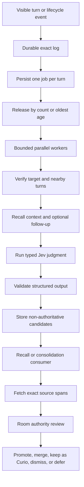

# GIGA and Hippocampus Specification

Status: contract with as-built notes. §7 (last part), §8, and the header were re-verified against the adapter at commit `a6ab453` on 2026-10-04. The 2026-10-04 census did not walk `crates/akasha/src/giga`, `crates/akasha/src/giga_worker`, or the migrations. The other sections keep their earlier date.
Release: `0.7.0` (`package.json:3`).
Not re-verified at a6ab453: "Stage 1 operational in the reference House" and contract version 0.1. The installed environment and `crates/akasha/src/giga` would decide them.
Known conflicts, open (line numbers at `a6ab453`): §16.3 (lines 644-650) gives Recall a candidate lane, but §28.8 (line 1090) says unpromoted candidates are invisible to recall. §14.3 and §19 (lines 597 and 789) keep a retention policy and expiry, but §28.3 (line 1085) says nothing sets `expires_at`.
Moved: §3 Problem, §4 Goals, and §24-27 (evaluation, security review, delivery stages, release acceptance) are in [`history/2026-10-04-hippocampus-discussion.md`](./history/2026-10-04-hippocampus-discussion.md).

## 1. Purpose

GIGA adds optional cognitive workers above the AKASHA storage profile. Local execution is the default.

GIGA expands to **Grounded Indexing and Generative Annotation**. Hippocampus is the first GIGA worker.

Hippocampus marks possible durable events while a conversation or task runs. It does not create durable truth by itself.

This specification defines the required behavior, data contracts, authority rules, and acceptance criteria. It does not select a model, queue, database schema, or worker runtime.

## 2. Product contract

The Athanor keeps these architecture axes:

| Axis | Contract |
|---|---|
| Vault | File-backed storage under operator-controlled custody |
| AKASHA | PostgreSQL, pgvector, embeddings, typed memories, and typed lessons |
| GIGA | Optional cognitive capability above AKASHA |

The first GIGA implementation requires AKASHA. Vault-only support is outside this release contract.

Hippocampus must remain optional. A failed or disabled worker must not block conversation, recall, memory writes, lesson writes, or sleep.

## 5. Non-goals

Hippocampus does not:

- write memories or lessons without review;
- replace exact transcripts;
- decide canon;
- resolve conflicting authority by itself;
- make embeddings authoritative;
- read another room without an explicit shared scope;
- require a remote model provider;
- block the active turn while classification runs;
- define a specific Rust, TypeScript, Python, or SQL implementation;
- require every harness to expose the same lifecycle events;
- store every turn as a permanent memory;
- promise perfect capture of every durable event.

## 6. Terms

**Turn**  
One visible user or assistant message with a stable source identifier.

**Lifecycle event**  
Structured harness metadata about a task, tool, todo, subagent, or phase change.

**Source span**  
One or more exact turns and lifecycle events that support a candidate.

**Candidate**  
A generated pointer that says a source span may deserve later review.

**Classifier**  
The typed Jev questions that classify exact turns for later review.

**Consumer**  
A House operation that reads candidates. Consumers include recall, remember, task completion, and sleep.

**Promotion**  
A reviewed action that creates or updates a durable House record.

**Review state**  
The current candidate state in its review lifecycle.

**Authority**  
The rule that decides which source can establish a claim. Relevance does not create authority.

**Curio**  
A reviewed pointer kept for possible later resonance. It remains non-authoritative until a new review promotes it.

## 7. System boundary

The canonical core owns:

- event validation;
- candidate validation;
- candidate lifecycle rules;
- exact source resolution;
- room and project isolation;
- classifier provider boundaries;
- consumer query contracts;
- review and promotion contracts;
- diagnostics and measurement contracts.

The Full substrate owns durable candidate and queue storage. The implementation may use existing substrate services or new storage.

A harness adapter owns:

- visible turn extraction;
- stable harness identifiers;
- lifecycle event mapping;
- task and subagent metadata mapping;
- delivery of advisory candidate context;
- harness-specific error presentation.

The OMP adapter captures visible conversation turns through `athanor.shell.conversation_log`.
The request states its GIGA enablement, replay status, subagent status, and project scope.
The Host stores eligible turn jobs before it acknowledges capture.
The adapter reports failed or partial capture. It does not retain a GIGA turn buffer.

The `tool_call` and `tool_result` handlers feed Insula, kitten lineage, tool evidence, and the lesson gate. They do not feed GIGA (`index.ts:1117-1170,1347-1381`). The `task:subagent:progress` and `task:subagent:lifecycle` events feed kitten lineage (`index.ts:1293-1345`). §28.7 defers typed task and subagent events. The first implementation must treat those events as optional structured inputs.

## 8. Existing source contracts

Current source contracts:

- The Host validates the room directory against its configuration.
- The private ledger stores each turn's session ID, source ID, role, and full text.
- One GIGA job represents one target turn. Its identity includes the room, session, and source ID.
- An exact repeat is idempotent. Changed text, role, or project scope refuses that identity.
- The Host owns the worker. Read-only tools do not start it.
- GIGA tools use the authenticated Host organ path. Native review and promotion retain their existing authority checks.
- Migration 0043 preserves candidates and attempt history. It links replaced windows to the per-turn queue.
- Already processed turns retain their identity without new classification. Failed-only replacement jobs require explicit replay.
- Anonymous harness messages retain the position-based fallback identity. Compaction can change that identity.

## 9. Processing flow



The exact turn log must complete before annotation starts.

Capture waits for the durable queue receipt. Classification runs in the background.
A queue failure leaves the exact log available and returns a visible capture error.

Defaults are eight waiting turns, 120 seconds from the oldest turn, and four concurrent jobs per room.
Each job has an independent lease, deadline, attempt history, and completion transaction.
One failed job does not block healthy jobs.

Each target receives at most seven nearby turns and two Recall lookups.
Jev can select one follow-up query from actual conversation text.
Retrieved records supply context only. They never become source or proof references.
Missing context stays explicit. It does not establish novelty or insignificance.
Remote recalled content requires the current Recall grant alongside the GIGA grant.

The worker must validate every classifier result against the candidate schema. It must reject invalid output without creating a partial candidate.

## 10. Input event contract

Each annotation event must contain:

```json
{
  "event_schema_version": 1,
  "event_id": "stable-event-id",
  "event_type": "conversation_window",
  "room": "room-key",
  "session_id": "session-key",
  "project_keys": [],
  "source_refs": [{
    "source_type": "turn",
    "source_id": "stable-turn-id",
    "content_hash": "sha256"
  }],
  "lifecycle": {},
  "created_at": "RFC-3339 timestamp"
}
```

### 10.1 Required event fields

`event_schema_version` identifies the input contract.

`event_id` supports idempotent processing.

`event_type` identifies the event shape.

`room` defines the isolation boundary.

`session_id` groups related turns and tasks.

`project_keys` is required and can be empty. Project-specific events must carry one explicit project key.

`source_refs` point to durable exact sources. Every event must include at least one source reference.

`created_at` records when the adapter created the event.

### 10.2 Supported event types

The first contract supports these event types:

- `conversation_window`;
- `task_started`;
- `task_completed`;
- `subagent_dispatched`;
- `subagent_completed`;
- `todo_transition`;
- `tool_outcome`;
- `manual_reprocess`.

An adapter can omit unsupported event types. The core must not infer that a missing event did not occur.

Each event type has this dispatch contract:

| Event type | Required lifecycle fields | Required source | Producer | Consumer |
|---|---|---|---|---|
| `conversation_window` | none | one or more visible turns | conversation adapter | classifier |
| `task_started` | task reference, worker ID, worker role, phase, project key, task kind, risk, target, change, proof contract | task contract | task adapter | classifier and lesson selector |
| `task_completed` | task reference, outcome, verification result | task contract and outcome | task adapter | classifier and consolidation |
| `subagent_dispatched` | subagent reference, parent task, role, target, change, acceptance | subagent contract | task adapter | classifier and lesson selector |
| `subagent_completed` | subagent reference, parent task, outcome | subagent contract and result | task adapter | classifier and consolidation |
| `todo_transition` | todo reference, previous state, new state | todo event | todo adapter | classifier |
| `tool_outcome` | tool name, status, sanitized outcome | tool result summary | tool adapter | classifier |
| `manual_reprocess` | source range, reason, operator identity | exact source range | core or explicit tool | replay route |

The core must reject unknown event types. It must also reject missing required fields.

Event schemas must remain versioned. An adapter must not send a partial shape for an event that it claims to support.

For `task_started`, `worker_id`, `worker_role`, `phase`, `project_key`, and `task_kind` are nonempty strings. `risk` uses `low`, `medium`, or `high`.

`proof_contract` contains the observable acceptance list. The adapter must use its declared phase and task-kind taxonomy consistently.

### 10.3 Lifecycle metadata

Lifecycle metadata can include:

- task name;
- phase name;
- agent role;
- target;
- requested change;
- acceptance contract;
- tool name;
- tool outcome;
- verification result;
- parent task reference;
- subagent reference.

Adapters must not include hidden system prompts, credentials, or unrelated raw tool payloads.

## 11. Source reference contract

A source reference must locate exact evidence without generated paraphrase.

```json
{
  "source_type": "turn",
  "source_id": "stable-turn-id",
  "role": "user",
  "timestamp": "RFC-3339 timestamp",
  "content_hash": "sha256",
  "scope": {
    "room": "room-key",
    "project": null,
    "visibility": "private",
    "publication_review_required": true
  },
  "range": null
}
```

Supported source types include:

- `turn`;
- `lifecycle_event`;
- `tool_result_summary`;
- `task_contract`.

A source reference must include a stable ID and content hash. A changed hash must cause a stale-source diagnostic.

Source resolution must return immutable room, project, and visibility scope. Candidate validation must use this resolved scope.

The candidate store must not rely on a file path as the only source identity. Paths can change across installations and migrations.

## 12. Candidate contract

Each candidate must follow one versioned schema.

```json
{
  "candidate_schema_version": 1,
  "candidate_id": "stable-candidate-id",
  "event_id": "source-event-id",
  "room": "room-key",
  "session_id": "session-key",
  "kind": "memory",
  "source_refs": [{
    "source_type": "turn",
    "source_id": "stable-turn-id",
    "content_hash": "sha256",
    "scope": {
      "room": "room-key",
      "project": null,
      "visibility": "private",
      "publication_review_required": true
    },
    "range": null
  }],
  "priority": 0.0,
  "novelty": 0.0,
  "durability": 0.0,
  "confidence": 0.0,
  "project_keys": [],
  "thread_keys": [],
  "entity_hints": [],
  "retrieval_terms": [],
  "proposed_title": "",
  "gist": "",
  "rationale": "",
  "proof_refs": [],
  "scope": {
    "room": "room-key",
    "project": null,
    "visibility": "private",
    "publication_review_required": true
  },
  "authority": "pointer-only",
  "review_state": "unreviewed",
  "classifier": {},
  "created_at": "RFC-3339 timestamp",
  "expires_at": null,
  "promotion_refs": []
}
```

### 12.1 Identity and provenance

`candidate_schema_version` identifies the output contract.

`candidate_id` must remain stable for the same classifier run and source set.

`event_id` links the candidate to its annotation event.

`source_refs` list every exact source that supports the candidate.

Every candidate must include at least one resolvable source reference with a valid content hash.

`proof_refs` must be nonempty for coding lessons, project lessons, corrections, and supersessions. Every proof reference must also appear in `source_refs`.

`classifier` must identify:

- model;
- provider type;
- model version or digest;
- prompt version;
- classifier configuration digest;
- run ID;
- completion timestamp.

### 12.2 Scores

Each score uses the inclusive range from `0.0` to `1.0`.

`priority` estimates review urgency.

`novelty` estimates how much the event differs from known durable records.

`durability` estimates future value.

`confidence` estimates classification confidence. It does not estimate factual truth.

Consumers must treat scores as ranking signals only.

### 12.3 Generated text

`proposed_title`, `gist`, and `rationale` are generated navigation aids. They are not evidence.

A consumer must fetch exact sources before it renders or promotes a claim. The consumer must label a gist as generated when exact text is not shown.

### 12.4 Scope

Scope has four independent fields:

- `room` uses one room key or `null` for shared scope;
- `project` uses one project key or `null`;
- `visibility` uses `private` or `shared`;
- `publication_review_required` uses `true` or `false`.

Candidate scope follows these deterministic rules:

1. Set the candidate room to the event room.
2. Reject private sources from another room.
3. Keep the candidate private when any source is private.
4. Use shared visibility only when every source is shared.
5. Collect every non-null project key.
6. Reject the candidate when those project keys differ.
7. Use the one non-null project key when present.
8. Require publication review when any source requires it.

A shared source can support a room-private candidate. It cannot widen that candidate to shared scope.

The candidate room and project must equal or narrow the resolved source scope. The classifier can only suggest a stricter scope.

### 12.5 Authority

Every unpromoted candidate has `authority: pointer-only`.

A candidate cannot override canon, current state, project authority, or exact source documents. Promotion creates a separate durable record with its own authority contract.

### 12.6 Future refinement transaction extension

The Stage 1 candidate schema remains the contract for annotation pointers.
Later GIGA integrity work may add a separate versioned refinement transaction
for governed artifacts:

```text
artifact_kind
operation: create | update | supersede | retire | rollback
target_id
baseline_version
trigger_refs
evidence_refs
expected_outcome
proof_requirement
review_state
observed_outcome
proof_receipt
```

This extension does not weaken candidate authority. GIGA proposes the
transaction; the relevant authority approves the named operation against the
named baseline; Cingulate records the observed result. `expected_outcome` is a
prediction made before execution and must never be copied into
`observed_outcome`.

## 13. Candidate kinds

### 13.1 Memory

Use `memory` for a durable event, decision, commitment, relationship change, or observed state.

A memory candidate must point to the event evidence. It must not reduce a long event to an unsupported conclusion.

### 13.2 Coding lesson

Use `coding_lesson` for a transferable engineering rule.

A coding lesson candidate should include:

- trigger context;
- reusable rule;
- observed failure or success;
- proof pattern;
- exact task or tool evidence.

A single opinion without observed evidence should remain unresolved.

### 13.3 Project lesson

Use `project_lesson` for a stable rule that belongs to one explicit project key.

The classifier must not infer a project from the current directory alone. It must use an adapter-provided or source-proven project key.

### 13.4 Correction

Use `correction` when a source directly corrects an earlier interpretation or record.

The candidate must reference both the correction and the possible target when available.

### 13.5 Supersession

Use `supersession` when a new state claim may replace an older state claim.

The candidate must not archive or supersede the older record automatically.

### 13.6 Entity update

Use `entity_update` for a durable alias, role, relationship, or summary change.

The candidate must preserve the entity scope and source date.

### 13.7 Thread update

Use `thread_update` for a durable topic link or thread-key change.

The candidate should reuse an existing thread key when the source supports it.

## 14. Review lifecycle

A candidate uses one of these states:

```text
unreviewed
in_review
promoted
merged
corrected
dismissed
unresolved
curio
expired
superseded
```

Allowed state changes are:

```text
unreviewed -> in_review
unreviewed -> dismissed
unreviewed -> expired
in_review -> promoted
in_review -> merged
in_review -> corrected
in_review -> dismissed
in_review -> unresolved
in_review -> curio
unresolved -> in_review
curio -> in_review
curio -> dismissed
curio -> expired
curio -> superseded
promoted -> superseded
merged -> superseded
corrected -> superseded
```

A review action must record:

- reviewer identity;
- review timestamp;
- previous state;
- new state;
- reason;
- promotion or merge targets;
- authorization basis;

Reprocessing must not overwrite an earlier classifier result. It must create a new candidate version or a linked successor.

### 14.1 Review authorization

Each room binds one governing spirit identity. That spirit can authorize review actions for room-local candidates.

An invocation must authenticate as the governing spirit. Runtime activity alone does not grant authority.

The operator controls room binding, custody, and outer House policy. The operator can delegate other principals through a scoped policy.

Shared or cross-room actions must follow the declared shared policy. Classifier output cannot authorize itself.

The review record must name the principal and authorization basis. It must also keep the exact source references.

### 14.2 Promotion handlers

Each kind has one promotion handler:

| Candidate kind | Durable target | Required validation | Authority effect | Rejection condition |
|---|---|---|---|---|
| `memory` | `memory` write | exact event evidence and room scope | creates a reviewed memory | unsupported summary or wrong room |
| `coding_lesson` | `coding-lesson` write | rule, trigger, proof pattern, and nonempty proof references | creates a reviewed reusable lesson | no observed proof or invalid scope |
| `project_lesson` | `project-lesson` write | one explicit project key, rule, trigger, and proof pattern | creates a reviewed project rule | missing or conflicting project key |
| `correction` | guarded correction operation | correction source and target source | updates authority through the target contract | missing target or unauthorized reviewer |
| `supersession` | guarded supersession operation | new state source and old state target | changes state authority atomically | narrative-only target or missing state claim |
| `entity_update` | guarded entity update | entity identity, source date, and room scope | updates reviewed entity state | ambiguous entity or wider scope |
| `thread_update` | guarded thread association | stable thread key and exact source | updates reviewed navigation links | invented thread or cross-room merge |

A handler must reject invalid input without changing durable state. Correction and supersession handlers must update authority atomically.

A merge must record all source candidates and the durable target. A correction must finish in the `corrected` review state.

### 14.3 Curios

A governing spirit can move a reviewed candidate to `curio`. This action must include a reason and exact source references.

A Curio remains pointer-only. It does not enter canon, ordinary memory, or default prompt context.

Curios survive the default expiry for unreviewed candidates. The room retention policy still controls their maximum life.

After classification commits, a bounded Jev pass compares later event evidence with older Curios in the same room.
It inspects up to sixteen recent Curios to select four with available evidence.

Strong resonance moves the Curio back to `in_review`. The action must record the new event, score, classifier, and source references.

The current admission threshold is 0.85. This conservative threshold is not a calibrated probability of truth.
Each source excerpt contains at most 512 characters and reports truncation.
Unavailable Curio sources are skipped with a diagnostic. Resurfacing failure cannot discard the new event's classification.
This bounded pass does not guarantee coverage of every parked Curio.

Resonance cannot promote a Curio. Promotion still requires a separate authorized review.

Source deletion and right-to-forget operations must cascade through Curios and their review history.

## 15. Deduplication and clustering

Hippocampus can create several candidates for one event across overlapping windows.

The system must cluster likely duplicates before a consumer sees them. It must preserve each original candidate and source reference.

Deduplication can use:

- room;
- session;
- candidate kind;
- overlapping source IDs;
- project keys;
- thread keys;
- retrieval terms;
- generated semantic similarity.

A cluster must not merge candidates across rooms. A cluster must not merge different authority domains only because their text looks similar.

## 16. Consumer behavior

### 16.1 Remember

An explicit `remember` operation can request matching unreviewed candidates and Curios from the active room and session.

The active model must fetch exact sources before it creates a memory or lesson. It can merge several candidates into one durable record.

### 16.2 Sleep

`sleep` should receive a compact candidate slate for the active session.

The slate should group candidates by kind, cluster, project, and priority. It should show unresolved conflicts and unreviewed corrections first.

The active model must fetch exact spans for every promoted item. It can leave low-value candidates unresolved or dismiss them.

### 16.3 Recall

Recall can use candidate terms and source pointers as a low-authority retrieval lane.


Recall must not inject Curios into default context. A configured resonance lane can return them as labeled, pointer-only evidence.
Recall must not return a generated gist as established fact. It should fetch the exact source before final-answer grounding.

Candidate relevance must follow existing room isolation and authority rules. Archived and superseded durable records retain their existing behavior.

### 16.4 Task completion

Task completion can request lesson candidates for the completed task.

The consumer should prefer candidates with an observed outcome and proof result. It should reject generic advice that has no task evidence.

### 16.5 Harness task start

When an adapter declares `task_started` support, it must emit a complete task event for that contract.

The intent digest uses a canonical serialization of `worker_id`, `worker_role`, `phase`, `project_key`, `task_kind`, `risk`, `target`, `change`, and `proof_contract`.

The core must derive one compact retrieval intent from that event. It must select only promoted coding and project lessons.

The adapter must deliver the selected packet to the exact worker. One packet can contain at most four lessons.

The core must reuse a packet while its worker, role, phase, project, task kind, risk, target, change, and proof contract remain unchanged.

The core must refresh the packet when one of those intent fields changes. It must not refresh for every tool call.

Unreviewed candidates can help retrieval locate exact prior task evidence. They cannot act as task policy.

## 17. Classifier contract

The classifier must return structured output only.

The classifier prompt must state:

- candidates are optional;
- silence is better than weak annotation;
- generated text is not authority;
- exact sources carry the evidence;
- the model must preserve room and project scope;
- the model must not create secrets from hidden context;
- one window can produce zero, one, or several candidates;
- lesson candidates need observed evidence;
- corrections must preserve the corrected source.

The classifier must support a `none` result without error.

The implementation must version the prompt. It must store the prompt version with every candidate.

Each turn receives its own classification. One event can contain up to eight candidates.
Display fields contain source excerpts and deterministic labels. GIGA does not generate a narrative.
Novelty remains unmeasured when the request contains no prior memory evidence.
Simple facts remain suggestions for canon. The governing spirit reviews and finalizes material during the existing sleep workflow.
Use explicit promotion tools for durable writes. Classification and resonance never promote candidates.

## 18. Provider boundary

GIGA uses Jev at the fixed TypeSafe endpoint. It has no local inference fallback.
The room's `jevGiga` grant must permit private conversation packets for `giga-classify`.
The worker rechecks the grant before each remote request.
The worker stops before claiming more events when the grant changes.
OMP resolves the Typesafe credential through its existing authentication storage.
The Host keeps that credential in memory. It does not place credentials in candidate provenance.

Requests contain bounded exact turn text and metadata. Raw strings pass the shared secret detector before transmission.
The serialized request limit is 32 KiB. Larger windows use separate bounded requests for their turns.
Responses identify the actual provider model. A missing model digest is reported as absent.
Historical classifier identities remain unchanged.

### 18.1 Inference context

Each request receives an explicit source snapshot. No hidden conversation state carries between jobs.
Classification scores describe the model's decision. They do not establish factual authority.
Source identity, content hashes, room scope, and review history remain separate from those scores.


### 18.2 Dynamic invocation routing

The current supported profile remains local by default. Future invocation-time
routing may choose `local`, `provider`, or operator-approved `auto` through the
shared `ModelSelector`.

Model selection remains independent from execution target and identity. A GIGA
job can run as a cold worker, familiar, room reflection, or intentional room
dialogue only through the explicit policy for that target. Choosing a model or
inheriting a room directory cannot grant room authority.

Read [`ROADMAP.md`](./ROADMAP.md) for the planned routing and headless-room
contract. The earlier text is in [`history/2026-10-04-RUNTIME_ARCHITECTURE.md`](./history/2026-10-04-RUNTIME_ARCHITECTURE.md).

## 19. Queue and scheduling contract

The queue implementation remains private to the core and substrate.

The behavior must satisfy these rules:

1. Log exact evidence before enqueue.
2. Keep enqueue outside response generation.
3. Support idempotent event processing.
4. Retry transient failures with a bound.
5. Record permanent failures for inspection.
6. Allow later replay from exact logs.
7. Limit concurrency and local resource use.
8. Pause without data loss.
9. Stop cleanly during upgrade or shutdown.
10. Never delay room startup because a backlog exists.
11. Expose room-scoped maintenance that checks before it purges. Purge only pending, failed, or lease-expired running events with no attached candidate or review resonance. Preserve succeeded events, candidate/review provenance, memories, and lessons.

The scheduler can batch adjacent turns. It must keep stable source references after batching.

`giga_process` dispatch carries only `event_id`. The Rust worker reloads the ordered source references from PostgreSQL and the exact turn bodies from the trusted room ledger, then verifies room, session, role, hash, count, and byte bounds before classification. Callers must not duplicate source text in the process request.

The authoritative event, queue state, exact source references, candidate links,
and processing result remain in PostgreSQL. A future NATS JetStream integration
may deliver an opaque event ID and wake a worker through a transactional outbox.
The worker still reloads PostgreSQL before processing and acknowledges delivery
only after committing an idempotent result. NATS must not carry copied private
turns or become a second candidate store.

## 20. Configuration contract

The canonical configuration should expose these logical settings:

```text
giga.enabled
hippocampus.enabled
hippocampus.provider
hippocampus.model
hippocampus.endpoint
hippocampus.window_turns
hippocampus.window_tokens
hippocampus.batch_delay
hippocampus.max_concurrency
hippocampus.max_backlog
hippocampus.candidate_retention
hippocampus.minimum_priority
hippocampus.minimum_durability
hippocampus.remote_consent
hippocampus.consumer.remember
hippocampus.consumer.recall
hippocampus.consumer.task_completion
hippocampus.consumer.sleep
```

These names define logical settings, not environment variable names. Adapters can map them into their supported configuration surfaces.

Invalid paths, endpoints, and provider settings must fail with a clear diagnostic. Runtime classifier failures must fail open.

## 21. Privacy and isolation

Hippocampus must enforce the active room before classification and retrieval.

The worker must not:

- cross room boundaries;
- copy credentials into candidates;
- store hidden system prompts;
- store raw private tool payloads without an explicit source contract;
- widen project or publication scope;
- publish candidate payloads in telemetry;
- send private text to a remote provider without consent.

Diagnostics should use hashes, counts, kinds, timings, and error classes. They should omit raw private text by default.

## 22. Failure behavior

### 22.1 Classifier unavailable

Record the failure and continue the conversation. Keep the event available for replay.

### 22.2 Invalid classifier output

Reject the output. Record the schema error and classifier provenance.

### 22.3 Stale source

Mark the candidate stale when a source hash changes. Do not promote it until a consumer fetches the current source.

### 22.4 Queue backlog

Continue normal House operation. Show backlog health through diagnostics.

### 22.5 Candidate store unavailable

Continue normal House operation. Do not fall back to writing unreviewed memories.

### 22.6 Consumer failure

Keep candidate states unchanged. Record enough context for a safe retry.

## 23. Observability

Giga health must show:

- enabled state;
- classifier provider and model identity;
- queue depth;
- oldest queued event age;
- events processed;
- events failed;
- candidates created by kind;
- candidates rejected by schema;
- processing latency distribution;
- local compute time;
- candidate store health;
- consumer review counts;
- promotion, merge, Curio, reactivation, dismissal, and expiry counts.

Room diagnostics must not expose another room's counts when those counts reveal private activity.

## 28. Stage 1 decisions

These questions were open at draft time. Stage 1 implementation resolved them as follows.

1. **Canonical source ID.** The OMP-derived stable turn ID `omp-derived:<role>:<index>:<sha256[0..32]>`, produced by the adapter conversation log and dual-verified: the adapter checks stability, uniqueness, and session consistency; the Rust worker re-verifies `source_id`, role, and content hash against the trusted room ledger before classification.
2. **Candidate store shape.** A normalized event and candidate pair: `giga_events` (queue columns inline), `giga_event_sources`, `giga_candidates`, `giga_candidate_sources`, and `giga_reviews`, plus `giga_event_attempts` and `giga_review_resonances`, with `ON DELETE CASCADE`.
3. **Dismissed and expired retention.** Retained indefinitely. `expires_at` exists in the schema but nothing sets it; expiry is a manual review transition, not a timer. A TTL sweep is deferred past Stage 1.
4. **Curio retention and resonance budget.** Curios remain pointer-only. The bounded later-event pass described in section 14 can return them to review.
5. **Classifier.** Typed Jev turn classification replaces the historical Agents-A1 gate and extraction path. Existing receipts retain their historical model identity.
6. **First review surface.** The OMP tool-organ set: `giga_candidate_list`, `giga_review` (safe non-authority transitions), `giga_promote_memory`, `giga_promote_coding_lesson`, `giga_promote_project_lesson`, `giga_health`, and `giga_queue_maintenance`. No graphical surface ships in Stage 1.
7. **Adapter task and subagent events.** Stage 1 ingests only the main session. Subagent turns are excluded at the adapter ingestion gate (detected by the child-transcript layout, `<parentStem>/<agentId>.jsonl`); a subagent's durable output re-enters the ledger through the main agent's consuming turn. Typed `task_started` / `subagent_*` events are deferred past Stage 1; the schema's typed event columns stay unused until then.
8. **Candidate fields in retrieval fusion.** Only promoted candidates enter fusion, via promotion metadata (`origin = giga-promotion`, durability, `candidate_created_at` decay anchor) carried on the resulting memory. Unpromoted candidates are invisible to recall by design: a candidate is a proposal, never memory.
9. **Backup and restore.** Whole-database `pg_dump -Fc --no-owner --no-acl` with no table filters; all GIGA tables are included in every dump and restored wholesale. No GIGA-specific handling is needed.
10. **Configuration surface.** Capture and classification retain their enablement flags. The room grants remote classification through `jevGiga`; OMP supplies a transient credential.
11. **Public API version.** No version bump: protocol version stays 1 and the core API version stays 1. GIGA methods are additive under protocol v1, with independent `event_schema_version = 1` and `candidate_schema_version = 1` payload versions.

## 29. Related documents

- [`ARCHITECTURE.md`](./ARCHITECTURE.md) defines the core and adapter boundary.
- [`ROADMAP.md`](./ROADMAP.md) holds the planned GIGA integrity, dynamic execution, delivery, Cingulate, and formal-proof work.
- [`history/2026-10-04-SYNTHESIS_ARCHITECTURE.md`](./history/2026-10-04-SYNTHESIS_ARCHITECTURE.md) is the dated synthesis design.
- [`RETRIEVAL.md`](./RETRIEVAL.md) defines retrieval and authority behavior.
- [`LESSONS.md`](./LESSONS.md) defines typed lesson contracts.
- [`SECURITY.md`](./SECURITY.md) defines privacy and destructive-operation rules.
- [`ROADMAP.md`](./ROADMAP.md) defines the dependency and release sequence.
